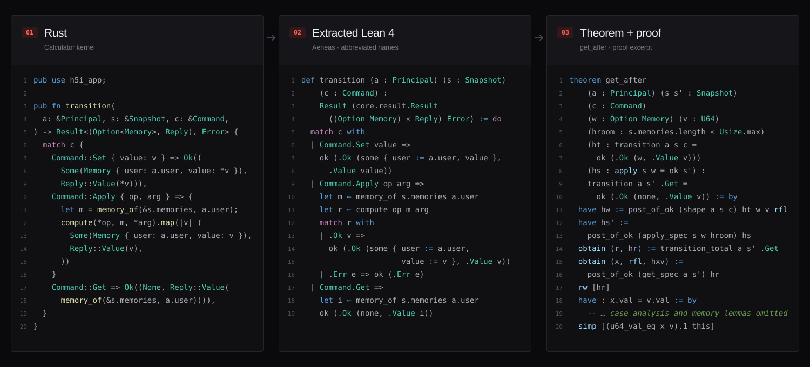
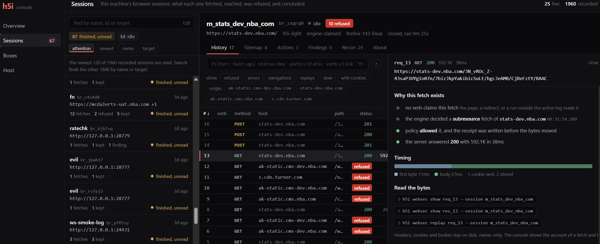

# h5i

<p align="left">
  <a href="https://github.com/h5i-dev/h5i/actions/workflows/test.yaml"></a>
  <a href="https://github.com/h5i-dev/h5i/stargazers"></a>
  <a href="https://github.com/h5i-dev/h5i/releases"></a>
</p>

**h5i** (pronounced *high-five*) is an Axum-based Rust web framework designed for formal verification with Lean 4 and optional GPU acceleration. It also provides integrated development infrastructure for browser automation, red-teaming, security regression testing, and sandboxed AI agents.

---

## 1. Install

```bash
# Add the Rust web framework
cargo add h5i-app

# Install the h5i CLI and development tools
curl -fsSL https://h5i.dev/install.sh | sh -s -- --websec --recon --test

# AI agent integration (optional)
npx skills add h5i-dev/h5i
```

---

## 2. Verifiable Web Framework

[`h5i-app`](crates/h5i-app/README.md) is a composable, Axum-based Rust web framework built around a verifiable application kernel.

- **Kernel-based architecture**: Separate application logic from infrastructure to verify and optimize core behavior.
- **Formal verification**: Translate Rust application logic into Lean 4 using [Aeneas](https://github.com/AeneasVerif/aeneas) and prove their properties.
- **Automatic specification generation**: Generate Lean 4 specifications and proofs for common patterns, including database schemas, authorization, and storage operations.
- **Embedded systems support**: Run HTTP/1.1 services on microcontrollers with a no_std, heap-free server backed by a Lean 4-verified parser.
- **Optional GPU acceleration**: Execute supported application kernels on GPUs while retaining CPU execution.

```toml
[dependencies]
h5i-app = { version = "0.5.3", features = ["http", "postgres"] }
```

<p align="center">
  
</p>

## 3. Development Infrastructure

h5i provides a unified CLI for building, verifying, debugging, and security-testing web applications with AI agents. For example, you can run professional red-teaming simply by opening your favorite AI agent harness and saying "Audit `https://<your-target>.com` with h5i." 

> The red-team, CI/CD, sandbox, and UI are framework-independent, so there's no need to adopt `h5i-app`.

**CLI Examples**

```bash

h5i app new counter && cd counter            # Scaffold a new Rust web app
h5i app extract                              # Extract Lean 4 models from Rust
h5i app prove                                # Verify properties with Lean 4
h5i app mutate                               # Test proof sensitivity with mutations

h5i browser open https://example.com         # Browser automation: Open a webpage
h5i browser click @e3                        # Click an element by reference

h5i websec requests                          # HTTP security testing: Inspect captured requests
h5i websec replay req_42 --set query.id=456  # Modify and replay a request

h5i recon crawl --max-requests 200           # Reconnaissance: Discover attack surfaces

h5i test .h5i-tests/tests/auth.yaml --target https://staging.example.com                # CI/CD: Run security tests
h5i test --target https://staging.example.com --openapi openapi.yaml --min-coverage 80  # Enforce API coverage

h5i box --name lab --profile browser         # Sandbox: Create an isolated environment
h5i box shell lab -- claude                  # Run Claude inside the sandbox

h5i ui                                       # Dashboard: Launch the local web interface
```

<p align="center">
  
</p>

---

## 4. License

h5i is licensed under the Apache License 2.0. See [LICENSE](LICENSE).
