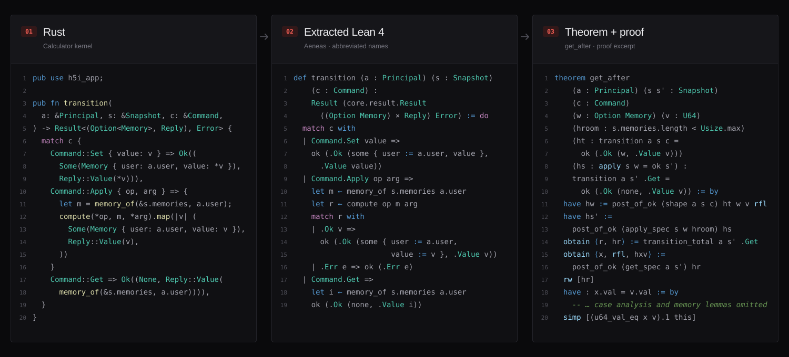
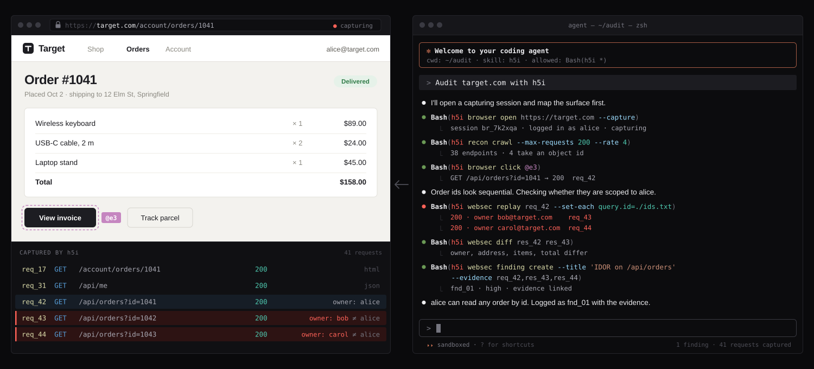
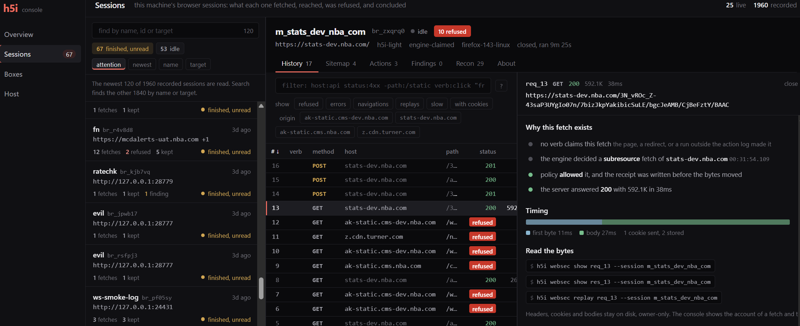

# h5i

<p align="left">
  <a href="https://github.com/h5i-dev/h5i/actions/workflows/test.yaml"></a>
  <a href="https://github.com/h5i-dev/h5i/stargazers"></a>
  <a href="https://github.com/h5i-dev/h5i/releases"></a>
</p>

**h5i** (pronounced *high-five*) is an Axum-based Rust web framework designed for formal verification with Lean 4 and optional GPU acceleration. It also provides integrated development infrastructure for browser automation, red-teaming, security regression testing, and sandboxed AI agents.

---

## 1. Install

```bash
# Add the Rust web framework
cargo add h5i-app

# Install the h5i CLI and development tools
curl -fsSL https://h5i.dev/install.sh | sh -s -- --websec --recon --test

# AI agent integration (optional)
npx skills add h5i-dev/h5i
```

---

## 2. Verifiable Web Framework

[`h5i-app`](crates/h5i-app/README.md) is a composable, Axum-based Rust web framework built around a verifiable application kernel.

- **Kernel-based architecture**: Separate application logic from infrastructure to verify and optimize core behavior.
- **Formal verification**: Translate Rust application logic into Lean 4 using [Aeneas](https://github.com/AeneasVerif/aeneas) and prove their properties.
- **Optional GPU acceleration**: Execute supported application kernels on GPUs while retaining CPU execution.

```toml
[dependencies]
h5i-app = { version = "0.1.4", features = ["http", "postgres"] }
```

<p align="center">
  
</p>

## 3. Development Infrastructure

h5i provides a unified CLI for building, verifying, debugging, and security-testing web applications with AI agents. For example, you can run professional red-teaming simply by opening your favorite AI agent harness and saying "Audit `https://<your-target>.com` with h5i." 

> The red-team, CI/CD, sandbox, and UI are framework-independent, so there's no need to adopt `h5i-app`.

<p align="center">
  
</p>

**Capabilities**

- **Project tooling:** Scaffold Rust web applications, extract Lean 4 models, check proofs, and test proof sensitivity.
- **Browser automation:** Navigate websites, interact with forms, and inspect authenticated workflows.
- **HTTP security testing:** Capture, modify, replay, and compare HTTP requests.
- **Reconnaissance:** Discover endpoints, parameters, and hidden attack surfaces.
- **CI/CD:** Replay security tests and enforce API coverage requirements.
- **Sandboxed environment:** Run isolated workflows with filesystem and network restrictions.
- **Dashboard:** Monitor browser sessions and agent activity through a local web interface.

**CLI Examples**

```bash
# Build and verify
h5i app new counter && cd counter
h5i app extract
h5i app prove
h5i app mutate

# Browser automation and red-teaming
h5i browser open https://example.com
h5i browser click @e3
h5i websec requests
h5i websec replay req_42 --set query.id=456
h5i recon crawl --max-requests 200

# Security regression testing
h5i test .h5i-tests/tests/auth.yaml --target https://staging.example.com
h5i test --target https://staging.example.com --openapi openapi.yaml --min-coverage 80

# Sandboxed environment
h5i box --name lab --profile browser
h5i box shell lab -- claude

# Local dashboard
h5i ui
```

<p align="center">
  
</p>

---

## 4. License

h5i is licensed under the Apache License 2.0. See [LICENSE](LICENSE).
